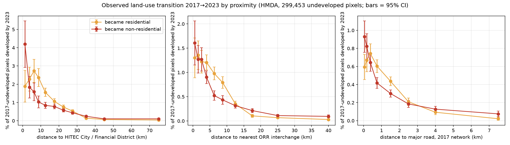
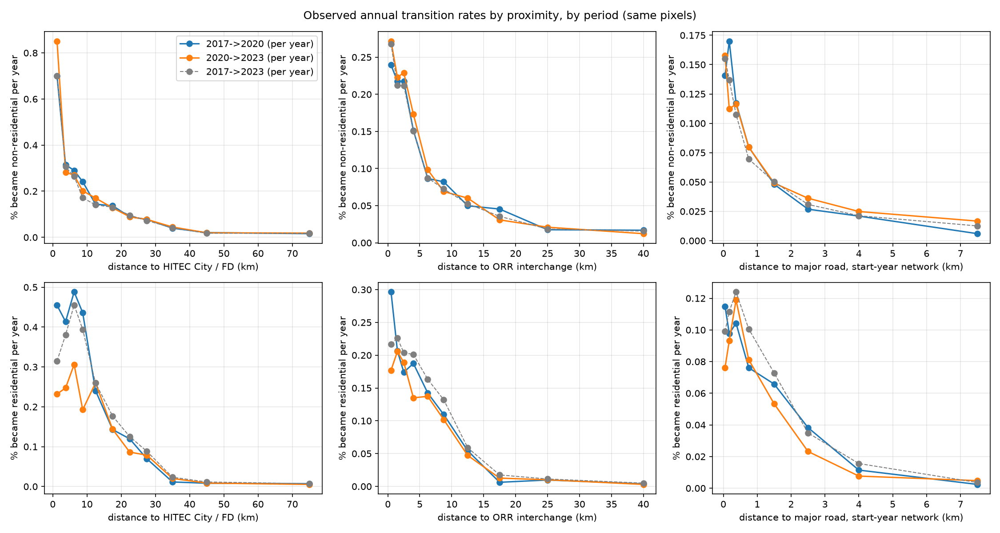

# Land-Use Transition (Choice) Models, HMDA 2017 → 2023: First Results

> **Earlier work (October 2026).** These 10 m models came before the meeting of early November. The change
> model that follows Table 18 of the UCF/FDOT report, on our 20 m maps, is in `outputs/change/README.md`.

**Run:** overnight, 2–3 October 2026

**Code:**
- `scripts/lu/20_proximity.py`: proximity variables
- `21_transition_data.py`: transition dataset
- `22_choice_models.py`: models
- `23_sisdp_raster.py`: NRSC SIS-DP layer
- chained by `run_choice_overnight.sh`

**Full auto-generated tables:** `outputs/lu/choice_2017_2023/REPORT.md` (main specification, no metro).
`outputs/lu/choice/` is the first run, which still had metro in the main specification; only its
observed-rate figure is used here.

---

## 1. Question

For land that was **undeveloped in 2017**, what is the probability that it became
**residential** or **non-residential** by 2023? How does that probability depend on
**proximity** to employment centres, the ORR, roads and metro, and does the relationship
differ by **context** (density, distance from the core)?

## 2. Data

| item | how it is built | why this way |
|---|---|---|
| **Unit** | 333,600 random 10 m pixels across HMDA (600 per 4 km tile). **299,453 were undeveloped in 2017** and are modelled. | |
| **Undeveloped in 2017** | Open Buildings 2.5D building cover under 5% in the pixel and under 10% within 70 m, and not water (53-feature classifier) | Open Buildings cover behaves consistently over time. Hard land-use classes do not (24% false change, §3b of HANDOFF.md). |
| **Developed by 2023** | cover ≥ 20% in the pixel and ≥ 10% within 70 m | Robustness checks use ≥ 10% and ≥ 30%. |
| **Residential vs non-residential** | 53-feature physical LightGBM applied to 2023 inputs; non-residential if P(non-res) / (P(res) + P(non-res)) > 0.5 | No AlphaEarth, so the same model is valid for 2017 and 2023. |
| **Proximity, measured as of 2017** | **Employment centre**: nearer of HITEC City (Cyber Towers) and Financial District. Old CBD (Abids). RGIA airport. Nearest ORR interchange. Nearest major road in the **2017** OSM network (from OSM history). Nearest metro station open by end-2017. | Measuring roads and stations as of 2017 means later infrastructure cannot "explain" earlier development. |
| **Controls, 2017** | building cover within 150 m and 610 m, NDVI within 150 m, night lights within 610 m, forest start state | |

**Outcome:**
- 99.3% stayed undeveloped;
- **0.37% became residential** (1,108 pixels);
- **0.33% became non-residential** (985 pixels).

## 3. Main result: development falls off steeply with distance

These are observed shares of 2017-undeveloped land developed by 2023, before any modelling.

| distance to HITEC City / FD | became residential | became non-residential |
|---|---|---|
| 0–2.5 km | 1.9% | **4.2%** |
| 2.5–5 km | 2.3% | 1.8% |
| 5–10 km | **2.4–2.7%** | 1.0–1.6% |
| 10–20 km | 1.1–1.6% | 0.8% |
| 20–30 km | 0.5–0.8% | 0.4–0.6% |
| 30–50 km | 0.1% | 0.1–0.2% |

**What this shows:**
- **Open land within 2.5 km of HITEC City / Financial District was about 40× more likely to
  become non-residential** than land 40+ km away (4.2% vs 0.1%).
- **Close to the employment centre, non-residential development dominates.** Residential
  development peaks in a **5–10 km ring** around it. This is the classic employment-core /
  residential-ring pattern.
- **ORR interchanges:** development probability halves between under 3 km and 5–10 km from an
  interchange.
- **Major roads:** non-residential development is concentrated within 250 m of a 2017 major
  road (0.8–0.9%, vs 0.1% beyond 5 km).

## 4. Multinomial logit (MNL): which proximity effects survive controls?

**Collinearity problem:**
- Distances to the CBD, HITEC City, the ORR and the metro move together (correlations
  0.7–0.9).
- With all of them included, CBD has a variance inflation factor (VIF) of 12 and metro 8.7,
  and individual coefficients become unstable.
- The specification we report drops metro. It has the highest collinearity, and earlier work
  found no robust metro effect.

**Reading the table:**
- Each distance enters as standardised ln(km).
- A **negative coefficient means closer → more likely**.
- Standard errors are clustered by 4 km tile.

| proximity (closer →) | residential vs none | non-residential vs none |
|---|---|---|
| HITEC City / Financial District | −0.13 (ns) | **−0.10 \*** |
| Old CBD (Abids) | **−0.58 \*\*\*** | −0.04 (ns) |
| ORR interchange | **−0.42 \*\*\*** | **−0.34 \*\*\*** |
| Major road (2017) | +0.07 (ns) | **−0.19 \*\*\*** |
| Airport | +0.27 \*\* (farther → more) | −0.03 (ns) |

Significance: \* p<0.05, \*\* p<0.01, \*\*\* p<0.001, ns = not significant.

| specification | McFadden R² | spatial-block CV AUC |
|---|---|---|
| Binary logit | 0.17 | 0.86 |
| MNL | 0.16 | – |
| LightGBM | – | 0.89 |

**Interpretation:**
- **Non-residential development** is pulled by the **IT employment centre, major roads and ORR
  interchanges**. It follows accessibility to jobs and to freight / through-traffic.
- **Residential development** is pulled by the **old CBD and ORR interchanges**, but **not**
  by major roads. Housing goes to the inner suburbs and the ORR belt, away from the arterials
  themselves.
- **ORR interchange access is the one effect that is strong for both types** and robust in
  every specification.

**Robustness** (binary logit, distance coefficients):

| check | ORR interchange coefficient |
|---|---|
| main | −0.37 |
| development threshold ≥ 10% cover | −0.32 |
| development threshold ≥ 30% cover | −0.39 |
| start state from NRSC SIS-DP 2016–19 instead of Open Buildings | −0.33 |
| 2023 road network (endogenous) instead of 2017 | −0.36 |

- The ORR effect stays between −0.32 and −0.39 in every check.
- The metro coefficient goes to ~0 when stations opened by 2020 are used. It is not robust,
  consistent with our earlier no-metro-effect finding.

## 5. Context classification

The same MNL was re-estimated separately by context (`D_context_*.csv`). This is the
"context classification" Prof. Eluru described.

| context | what drives **non-residential** conversion |
|---|---|
| **Middle ring (10–25 km from CBD)** | ORR interchanges (−0.20 \*\*), local density, night lights |
| **Periphery (> 25 km)** | **major roads (−0.23 \*\*\*)**, night lights. HITEC City / FD is −0.24 (ns); it is −0.34 \* only when metro distance is also in the model |
| Core (< 10 km) | too little open land left (52 events) to estimate |
| High vs medium surrounding density | ORR matters in both. Low-density areas had too few conversions to estimate. |

So the drivers **do differ by context**: in the periphery, being on a major road matters
most, while in the middle ring ORR access dominates. The IT-corridor effect in the periphery
has the expected sign but is not significant in the main specification.

**LightGBM SHAP curves** (`C_shap_distance_decay.png`) show the effects are **non-linear**:
- the employment-centre effect on residential conversion is positive between ~5 and 20 km and
  turns sharply negative beyond 40 km;
- the major-road effect drops off after ~3–5 km.

## 6. Caveats

1. **Rare outcome.** 0.7% of undeveloped pixels developed, about 2,100 events. Enough for
   these models, but thin for fine context splits.
2. **Function of new development comes from the classifier** (non-residential F1 ≈ 0.4). The
   residential vs non-residential split is uncertain. The binary develop / not-develop result
   is the most reliable.
3. **Straight-line distances.** Network travel time is the next step, as Prof. suggested.
4. **OSM history** also reflects mapping effort: 4,441 km of major roads mapped in 2017 vs
   5,251 km in 2023.
5. **Centrality variables are collinear.** Read individual radial coefficients with care.
   The observed-rate curves (§3) do not have this problem.

## 7. Next steps (before 15 October)

1. **Network travel time** to HITEC/FD, CBD and ORR on the 2017 road graph, replacing
   straight-line distances.
2. **Latent segmentation logit** (Eluru-style): let the model find the contexts itself, with
   segment membership depending on density and ring. Code exists from the earlier 300 m work
   (`scripts/overnight/m2_choice_models.py`).
3. **Two periods**, 2017→2020 and 2020→2023. 2020 inputs are downloading now. This tests
   whether the effects are stable over time.
4. **Zone level:** aggregate to a 500 m–1 km grid or wards, so the outcome is the
   *share of land converted* and less noisy.
5. **Bhuvan:** after login, request the SIS-DP vector data formally.

## 8. Output files

| file | content |
|---|---|
| `outputs/lu/choice_2017_2023/REPORT.md` | all model tables, auto-generated (main specification) |
| `outputs/lu/choice/observed_rates_by_distance.png/.csv` | §3 figure and table |
| `A_binary_logit.csv`, `B_mnl.csv` | coefficient tables (main specification; metro enters only in `E_robustness.csv`) |
| `B_probability_curves.png`, `B_curve_*.csv` | MNL predicted probability vs distance |
| `C_shap_distance_decay.png`, `C_shap_importance.csv` | LightGBM non-linear effects |
| `D_context_density_nonres.csv`, `D_context_ring_nonres.csv` | context classification |
| `E_robustness.csv` | robustness checks |
| `data/processed/lu/transition_2017_2023.parquet` | the pixel dataset (333,600 rows) |
| `data/raw/lu/sisdp/` | NRSC SIS-DP 2016–19 rasterised on our grid (code + 5-class) |

---

# Update (3 October): stability over time + latent segmentation

**Code:** `scripts/lu/21_transition_data.py` (panel version), `24_period_compare.py`,
`25_latent_segmentation.py`

**Outputs:** `outputs/lu/choice_periods/`, `outputs/lu/choice_latent/`

## 9. Two separate periods give the same answer

**Set-up:**
- The same 333,600 pixels were measured in **2017, 2020 and 2023**.
- Each period uses the road network and metro stations **as they existed at its own start
  year** (OSM major roads: 4,441 km in 2017, 4,724 km in 2020, 5,251 km in 2023).

**The pace of development is steady:**

| period | developed by end | residential | non-residential |
|---|---|---|---|
| 2017→2020 | 0.33% (0.11%/yr) | 0.16% | 0.17% |
| 2020→2023 | 0.32% (0.11%/yr) | 0.15% | 0.17% |

**Coefficients estimated separately per period** (standardised ln distance; negative = closer → more likely):

| effect | 2017→2020 | 2020→2023 | verdict |
|---|---|---|---|
| ORR interchange → developed | −0.34 \*\*\* | −0.38 \*\*\* | **stable** |
| ORR interchange → residential | −0.45 \*\*\* | −0.45 \*\*\* | **stable** |
| ORR interchange → non-residential | −0.27 \*\*\* | −0.32 \*\*\* | **stable** |
| major road → non-residential | −0.26 \*\*\* | −0.13 \* | stable sign, weaker later |
| old CBD → residential | −0.53 \*\*\* | −0.41 \*\*\* | **stable** |
| HITEC City / FD → residential | −0.16 \* | −0.04 (ns) | fading |
| HITEC City / FD → non-residential | −0.07 (ns) | −0.03 (ns) | weak once CBD/ORR are controlled |

Significance: \* p<0.05, \*\* p<0.01, \*\*\* p<0.001, ns = not significant.

**What this shows:**
- **The observed non-residential curves are almost identical in the two independent periods.**
  The non-residential rate near HITEC City / FD is about 0.7–0.85% of open land per year,
  falling to about 0.02% per year beyond 40 km.
  - This is the strongest evidence that the proximity effect is real, not model noise.
  - Contrast this with the hard-class change maps, which flip-flopped.
- **Residential development near the IT corridor slowed in 2020–23.** It fell from about
  0.45% to 0.25% per year within 10 km of HITEC City / FD, while the rate further out held.
  The likely reason is that open land near the core is running out and housing is moving
  outward, but this is a hypothesis to check.
- **In the regressions, the HITEC City / FD coefficient is weak, but the observed curve is
  steep.** The model can't separate the HITEC effect from CBD and ORR access, because those
  distances move together.
  - For the paper, report the observed curves and the "employment centre" effect jointly.
  - Alternatively, use a single **accessibility index** (travel time to jobs) instead of
    several correlated distances. This is the network travel-time step.

## 10. Latent segmentation logit: the model finds the contexts itself

The model is a binary logit of development, 2017→2023. Segment membership depends on
surrounding building density and distance to the old CBD. **BIC prefers 3 segments.**

| | **segment A: "dormant" land** | **segment B: "infill"** | **segment C: "growth corridor"** |
|---|---|---|---|
| share of undeveloped land | 93% | 5% | 3% |
| who is in it | most rural / peripheral land | land with denser surroundings, closer to the CBD | land fairly independent of CBD distance |
| baseline development | almost never develops | active | active |
| HITEC City / FD | – | +0.11 \*\* (slightly *farther*) | **−0.56 \*\*\*** |
| ORR interchange | – | −0.23 \*\*\* | **−0.71 \*\*\*** |
| major road | – | +0.32 \*\*\* (*away* from arterials) | −0.18 \* |
| night lights (2017) | – | ~0 | +3.3 \*\*\* |

Segment A's coefficients are not meaningful, because almost nothing in it develops.

**How to read it:**
- **There are two different land markets.**
  - **Infill** happens in already-dense inner areas, *off* the main roads. It is filling
    gaps between existing buildings.
  - **Corridor growth** is pulled strongly by the **IT employment centre, ORR interchanges
    and major roads**, in areas that were already lit at night in 2017.
- This is the "context classification" Prof. Eluru described, found **from the data** rather
  than imposed by density tertiles. It is also his own method (latent segmentation).

**Caveat:** standard errors in the segmentation model are not clustered (Hessian only), so
the significance levels are optimistic.

## 11. Still to do before 15 October

1. **Network travel time / job accessibility** on the 2017 road graph. This should resolve
   the HITEC vs CBD vs ORR collinearity.
2. **Zone-level version** (1 km grid or wards).
3. Clustered or bootstrap standard errors for the latent segmentation model.
4. A slide deck of these results for Prof. Eluru.
