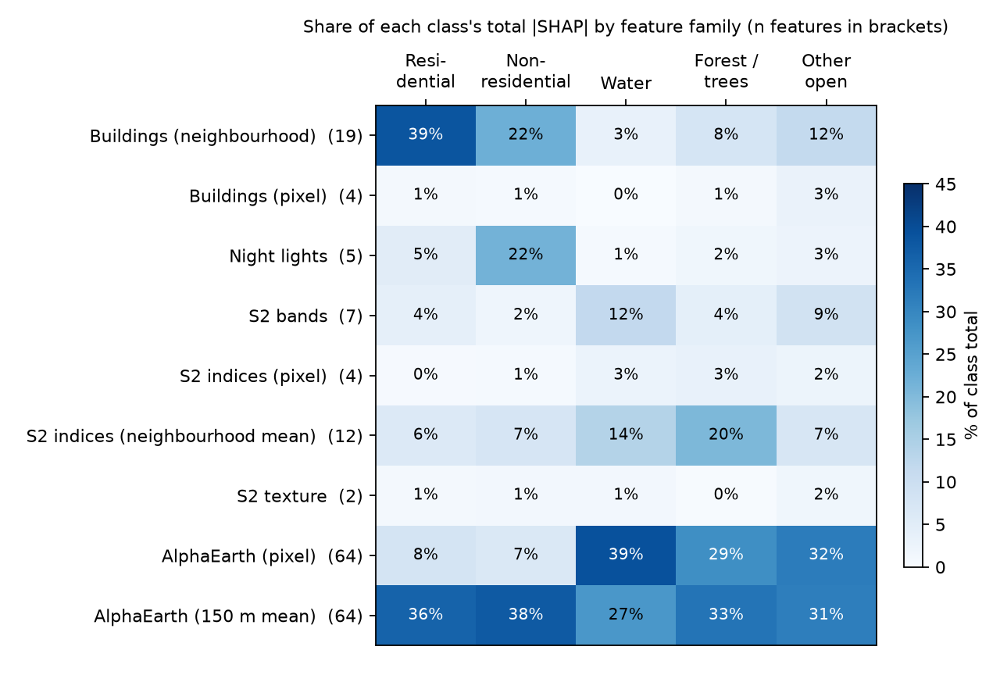

# The 181 Features: What They Are, How They Are Computed, What Each One Is For

**Code:**
- `scripts/lu/lu_common.py`: raw download
- `scripts/lu/lu_features.py`: feature engineering
- `scripts/lu/15_feature_analysis.py`: this analysis

**Outputs:** `outputs/lu/features/`

---

## 1. Summary

- **181 features, but only 9 kinds.** They come from **four raw data sources** (Sentinel-2,
  Open Buildings 2.5D, VIIRS night lights, AlphaEarth). Most are the same measurement taken at
  several neighbourhood sizes.
- **128 of the 181 are AlphaEarth embedding dimensions.** Only 53 are hand-made.
- **Most features can be removed on the hand-labelled test.** With just **15 features** the
  model scores **0.628** macro-F1, the same as with all 181 (0.627).
  - With the **53 features that exclude AlphaEarth**, it scores **0.626**.
  - With 313 test pixels, every hand-label confidence interval is about ±0.07, so these
    differences are not significant.
  - Extra features help only on the larger OpenStreetMap-label spatial cross-validation
    (0.863 with 15 → 0.894 with 181).
- **Building features are the one group we cannot drop.** Removing them gives the largest
  loss on both tests: hand-label score −0.04, CV −0.02.
- **Legend:**

  | class | what identifies it |
  |---|---|
  | residential | many buildings per neighbourhood |
  | non-residential | bright night lights + large building footprints |
  | water | MNDWI + low SWIR reflectance |
  | forest | NDVI averaged over 70 m |
  | open | low building cover |

  AlphaEarth supports all five classes, but it is largely redundant with the physical features.

---

## 2. The full list

### Raw inputs: 76 bands, downloaded once per year

| source | bands | native res. | how it is made into one 2023 layer |
|---|---|---|---|
| Sentinel-2 L2A (harmonised) | B2 blue, B3 green, B4 red, B5 red-edge, B8 NIR, B11 SWIR-1, B12 SWIR-2 (**7**) | 10 m (B5, B11, B12 at 20 m) | Median of all 2023 scenes, cloudy pixels masked with Cloud Score+ (cs_cdf ≥ 0.6) |
| Google Open Buildings 2.5D Temporal | building cover, mean height, max height, building count (**4**) | 0.5 m | Aggregated to 10 m: cover = share of 0.5 m cells with a building; height = mean and max over building cells; count = sum of fractional counts |
| VIIRS DNB annual | average radiance (**1**) | ~500 m | 2023 annual composite |
| AlphaEarth Foundations (Google) | A00 … A63 (**64**) | 10 m | 2023 annual embedding: a learned 64-number summary of a year of multi-sensor data |

### Engineered features: 76 bands → 181 columns

| # | family | features | formula / meaning |
|---|---|---|---|
| 7 | **S2 bands** | `B2 B3 B4 B5 B8 B11 B12` | reflectance (0–1) |
| 4 | **S2 indices (pixel)** | `ndvi` `ndbi` `mndwi` `bsi` | NDVI = (B8−B4)/(B8+B4) vegetation · NDBI = (B11−B8)/(B11+B8) built-up · MNDWI = (B3−B11)/(B3+B11) water · BSI = ((B11+B4)−(B8+B2))/((B11+B4)+(B8+B2)) bare soil |
| 12 | **S2 indices (neighbourhood mean)** | `ndvi_w` `ndbi_w` `mndwi_w` for w = 7, 15, 31, 61 | mean of the index over a w × w pixel window: 70 m, 150 m, 310 m, 610 m |
| 2 | **S2 texture** | `b8_sd_7` `b8_sd_15` | standard deviation of NIR over 70 m / 150 m (roughness) |
| 4 | **Buildings (pixel)** | `ob_cov` `ob_h` `ob_hmax` `ob_cnt` | building cover share, mean height (m), max height (m), number of buildings |
| 19 | **Buildings (neighbourhood)** | `cov_w` `cnt_w` `bldg_area_w` `bldg_h_w` (w = 7, 15, 31, 61); `hmax_15` `hmax_31`; `h_sd_15` | cover; buildings per window; **mean footprint size** = cover ÷ count (relative units, not m²: see `DATA.md` section 8); cover-weighted **mean height**; max height; height variability |
| 5 | **Night lights** | `viirs` `viirs_7` `viirs_15` `viirs_31` `viirs_61` | radiance, and its mean over each window |
| 64 | **AlphaEarth (pixel)** | `A00` … `A63` | embedding at the pixel |
| 64 | **AlphaEarth (150 m mean)** | `A00_15` … `A63_15` | embedding averaged over 150 m |
| **181** | | | |

Every feature is listed with its family, window and description in
`outputs/lu/features/feature_catalogue.csv`.

**Why neighbourhood windows?** A single 10 m pixel cannot show that it sits inside an
industrial estate or a dense colony, but its surroundings can. The four window sizes run from
a building plot (70 m) to a neighbourhood (610 m).

---

## 3. Computation and storage

**What is stored:**

| stage | stored? | size | format |
|---|---|---|---|
| Raw 76-band inputs, 2023, all HMDA | yes | **7.3 GB** | 556 GeoTIFF tiles, each 4 km × 4 km = 400 × 400 px × 76 bands, int16 |
| 181 features, wall-to-wall | **no** | would be ~64 GB as float32 | computed on the fly, tile by tile |
| 181 features at training pixels | yes | 161 MB | `samples.parquet`: 393,098 rows × 181 features + label |
| 181 features at the 325 test pixels | yes | small | `validation_features.parquet` |
| Trained model | yes | 14 MB | `model_all_2023.pkl` |
| Output map | yes | 48 MB | 556 tiles (class + confidence), plus a mosaic `landuse_hmda_2023_10m.tif` |

**How features are computed** (`lu_features.compute`):

1. **Download** from Earth Engine as int16 with scale factors, e.g. reflectance ×10⁴ and
   height ×10. This halves storage compared with float32.
   - The project is in Earth Engine's restricted mode, so each 76-band tile is fetched in
     3 parts with at most 2 parallel workers. The 2023 download took one night.
2. **For each tile**, read it together with its 8 neighbours and keep a 40-pixel margin.
   This means window features have no seams at tile edges.
3. **Window means** use a running-sum filter (`scipy.ndimage.uniform_filter`). Its cost does
   not depend on window size, so a 610 m window costs the same as a 70 m one.
   - About **4 s per tile** on the laptop CPU (measured: 221 tiles in 15 min).
   - About **40 min for all 556 tiles**.
4. **Training** only needs the sampled pixels (393k rows).
   - One LightGBM fit on 300k rows × 181 features takes **~4 min on 16 CPU threads**.
   - **Cost grows roughly linearly with the number of features**, so 53 features is about
     3–4× cheaper than 181.
5. **Prediction** is tile by tile: compute features, predict, write, discard. Peak memory is
   one tile's features: 181 × 160,000 × 4 bytes ≈ **115 MB**.

**Where the 181 is expensive:** the **AlphaEarth features are 128 of 181 columns (71%)**.
They make up most of the download (64 of 76 bands, about 6 of the 7.3 GB), most of the
training time, and most of the per-tile prediction cost.

---

## 4. Legend: which features identify which class

**Method:**
- We used **SHAP** values from the trained model on 20,000 pixels (4,000 per class).
  A feature's SHAP value is how much it pushed that pixel's prediction towards or away from
  each class.
- We then summed each family's share of every class's total importance.
- **Direction** is the rank correlation between a feature's value and its SHAP value.
  **+** means higher values push *towards* the class; **−** means *away from* it.

| class | top features (↑ = higher value → more likely this class) | in plain words |
|---|---|---|
| **Residential** | `cnt_15` ↑, `cnt_7` ↑, `cnt_61` ↑, `cnt_31` ↑ (building count); `hmax_31` ↑; `bldg_h_61` ↑ | **Many buildings close together.** Building count at 70–610 m is the residential signature. Building families supply 40% of residential importance. |
| **Non-residential** | `viirs_61` ↑, `viirs` ↑, `viirs_7` ↑ (night lights); `bldg_area_61` ↑, `bldg_area_31` ↑ (footprint size) | **Bright at night and made of big buildings.** Night lights (22%) and large mean footprints (factories, offices, malls) separate it from housing. |
| **Water** | `mndwi_7` ↑; `B11` ↓ (SWIR); `B8` ↓ (NIR); AlphaEarth `A24` ↓, `A17` ↓ | Water absorbs infrared, so SWIR and NIR are low and MNDWI is high. Water is the easiest class. |
| **Forest / trees** | `ndvi_7` ↑, `ndvi_15` ↑; `B12` ↓; AlphaEarth `A20` ↓, `A50` ↓ | **Green over a 70–150 m patch**, not just one green pixel. This separates tree stands from crops or lawns. |
| **Other open** | AlphaEarth `A46` ↑, `A55` ↑; `cov_7` ↓ (building cover); `B4` ↑, `B12` ↑ (bright red/SWIR) | **No buildings and bright bare or dry ground.** Farmland versus barren land is left mostly to AlphaEarth. |

The full table (every feature × class, with directions) is in `shap_by_class.csv`.

**How to read AlphaEarth's large share.** AlphaEarth takes 30–70% of the SHAP importance for
every class, but removing it costs nothing on the hand-labelled test (§5).
- SHAP shows what the model **used**, not what it **needs**.
- The embeddings largely re-encode information already present in Sentinel-2 and
  the building features. Given 128 of them, the model spreads its splits across them.
- Also, 64 dimensions are summed into each AlphaEarth row. **Per feature**, a building or
  night-light feature carries 2–3× more importance than an average AlphaEarth dimension
  (night lights 0.41, neighbourhood buildings 0.31, AlphaEarth 0.15–0.20 mean |SHAP| per feature).

---

## 5. Can the 181 be reduced or combined? Tested

**Set-up:**
- Same spatial cross-validation as the main model: 12 km blocks, 5-fold GroupKFold, on a
  120k-pixel class-balanced subsample.
- Each set is also scored on the 313 confident hand-labelled pixels, stratum-weighted.
- Top-K features are **chosen inside each training fold**, so no information leaks from the
  test fold.
- PCA is also **fitted on the training fold only**.

| feature set | # features | spatial CV macro-F1 | hand-label macro-F1 [95% CI] | hand F1 res. | hand F1 non-res. |
|---|---|---|---|---|---|
| **ALL** | **181** | **0.894** | 0.627 [0.55–0.69] | 0.71 | 0.41 |
| − AlphaEarth 150 m means | 117 | 0.891 | 0.611 [0.54–0.68] | 0.72 | 0.37 |
| **− all AlphaEarth** (physical features only) | **53** | 0.873 | **0.626** [0.55–0.69] | 0.72 | 0.40 |
| **− buildings (pixel + neighbourhood)** | 158 | 0.874 | **0.587** [0.51–0.65] | 0.65 | **0.34** |
| − S2 neighbourhood means + texture | 167 | 0.891 | 0.620 [0.55–0.69] | 0.69 | 0.40 |
| − night lights | 176 | 0.895 | 0.614 [0.54–0.68] | 0.69 | 0.42 |
| **AlphaEarth → PCA (16 + 8 components)** | **77** | **0.888** | 0.621 [0.55–0.69] | 0.69 | 0.36 |
| Correlation-pruned (|ρ| ≥ 0.9 → one per cluster) | 111 | 0.891 | 0.612 [0.54–0.68] | 0.70 | 0.43 |
| Top-60 by importance | 60 | 0.889 | 0.604 [0.53–0.67] | 0.65 | 0.38 |
| Top-30 by importance | 30 | 0.875 | 0.619 [0.54–0.70] | 0.68 | 0.35 |
| **Top-15 by importance** | **15** | 0.863 | **0.628** [0.56–0.70] | 0.69 | 0.37 |
| Pruned + AlphaEarth PCA | 51 | 0.887 | 0.609 [0.53–0.69] | 0.67 | 0.36 |

**What this shows:**

1. **Building features matter most.** They are the only group whose removal clearly hurts:
   - non-residential F1 falls from 0.41 to 0.34;
   - residential F1 falls from 0.71 to 0.65.
2. **AlphaEarth is replaceable.**
   - Removing all 128 dimensions leaves the hand-label score unchanged (0.626).
   - Compressing them to 24 PCA components keeps spatial CV at 0.888.
   - They add about +0.02 only on OpenStreetMap-style labels.
3. **Many features are near-duplicates.**
   - Correlation clustering merges 181 features into 111 groups at |ρ| ≥ 0.9.
   - Mostly these are the same index at neighbouring window sizes, and pixel vs 150 m
     AlphaEarth.
4. **On the independent test, 15 features ≈ 181 features.**
   - The larger sets are better only on the bigger but easier OSM-label test (+0.03).
   - With 313 hand-labelled pixels we cannot distinguish any two sets. All intervals overlap.

**The 15 features the top-15 model picks** (full-data run):

| family | features |
|---|---|
| Sentinel-2 | `B11`, `B8`, `ndvi`, `ndvi_7`, `mndwi_7` |
| Buildings | `cnt_15`, `cnt_7`, `cnt_31`, `bldg_area_31`, `bldg_area_61`, `bldg_h_31` |
| AlphaEarth | `A42`, `A46`, `A50`, `A00` |

That is 5 Sentinel-2 + 6 building + 4 AlphaEarth features.

### Recommendation

| use | feature set | why |
|---|---|---|
| **Default going forward** | **53 physical features (no AlphaEarth)** or **AlphaEarth → PCA, 77** | Same hand-label accuracy as 181. Fully interpretable (every feature has a physical meaning). About 3× faster. No 6 GB embedding download each year. |
| **Change over time (2017 → 2023)** | **53 physical features** | Earlier we found AlphaEarth embeddings drift between years. Building and Sentinel-2 features are physically consistent across years. |
| **Compact model for explanation / slides** | **Top-15** | Shows that a handful of building-count, footprint-size, NDVI and SWIR features do most of the work. |
| Keep 181 only if | the OSM-label CV score matters | +0.02–0.03 on CV only |

**What we don't recommend:** further blind pruning. The real limit is the **non-residential
class (F1 ≈ 0.4 in every set)**, not the number of features. More features of the same kinds
will not fix it. Features that carry new information would: points of interest, SIS-DP
industrial and institutional polygons as labels, or height in finer detail.

---

## 6. Files

| file | content |
|---|---|
| `outputs/lu/features/feature_catalogue.csv` | all 181 features: family, window, description |
| `outputs/lu/features/shap_by_class.csv` | per-feature × class mean \|SHAP\| and direction |
| `outputs/lu/features/shap_family_by_class.csv` | same, by family |
| `outputs/lu/features/feature_legend_heatmap.png` | the legend figure |
| `outputs/lu/features/corr_clusters.csv` | redundancy clusters (|ρ| ≥ 0.9) and which member is kept |
| `outputs/lu/features/reduced_sets_cv.csv`, `reduced_sets_handlabel.csv` | the §5 table |
