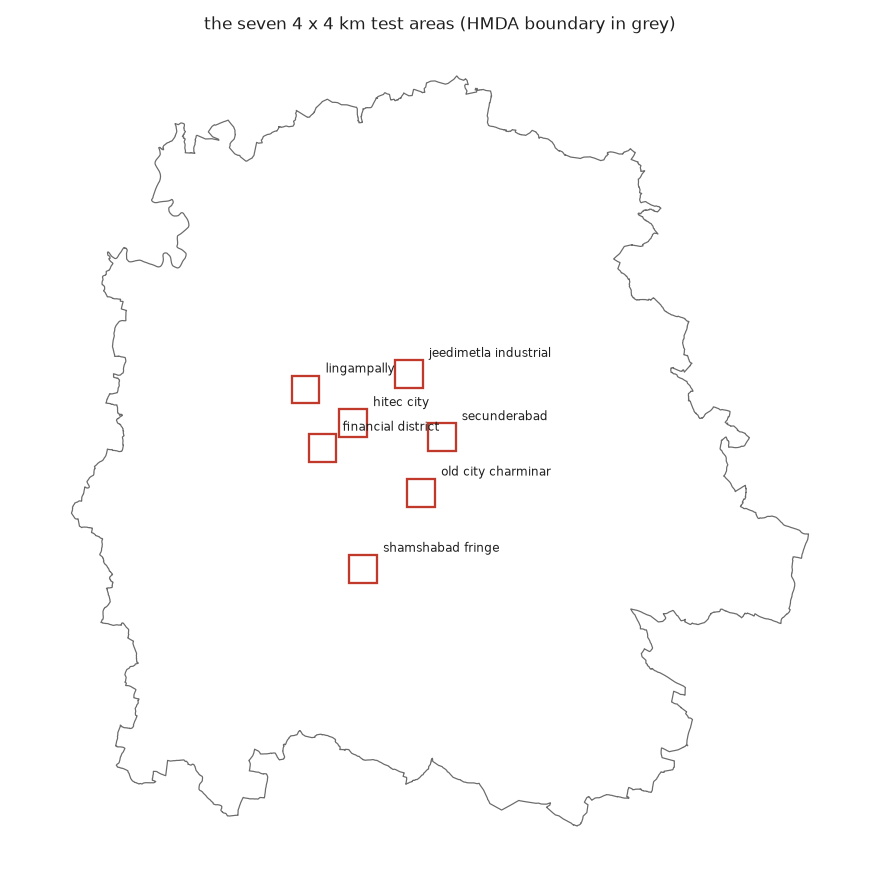
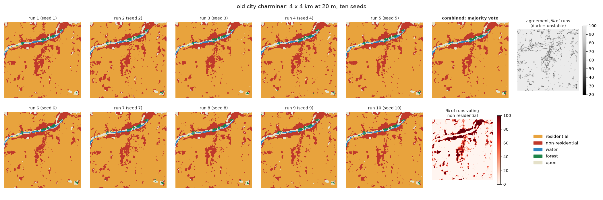
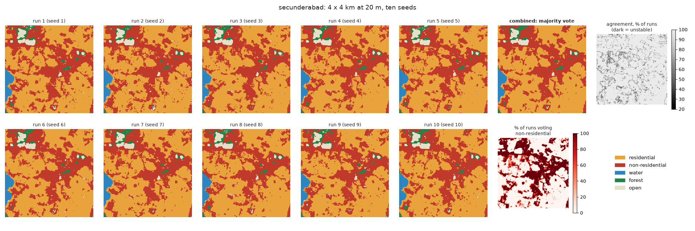
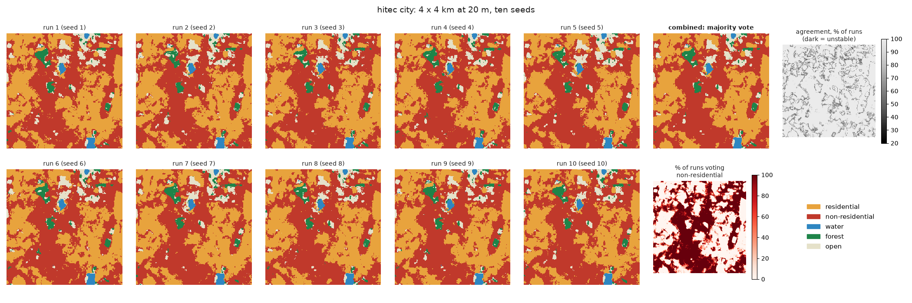
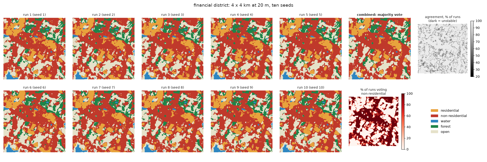
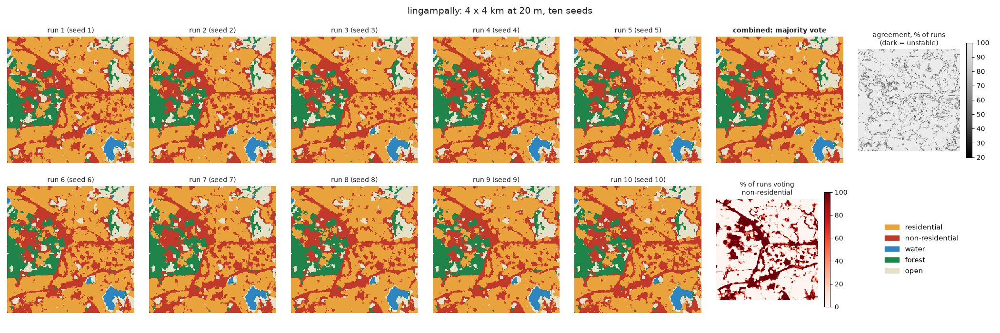
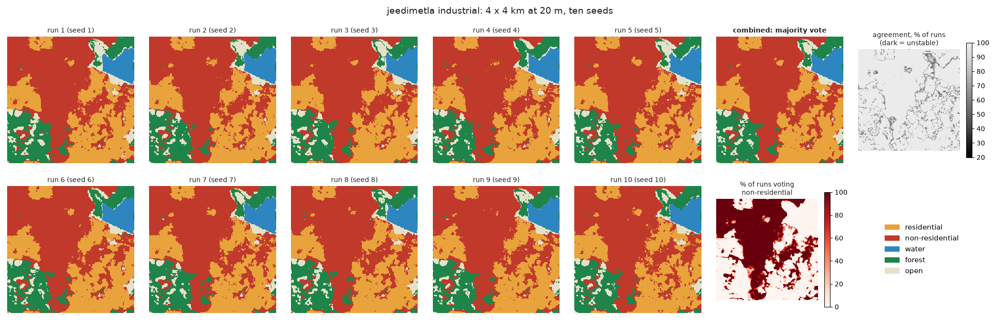
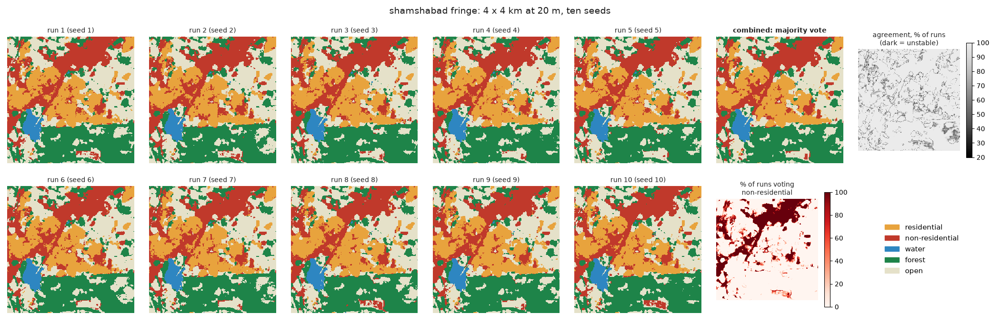
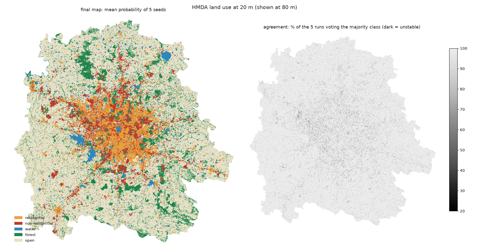
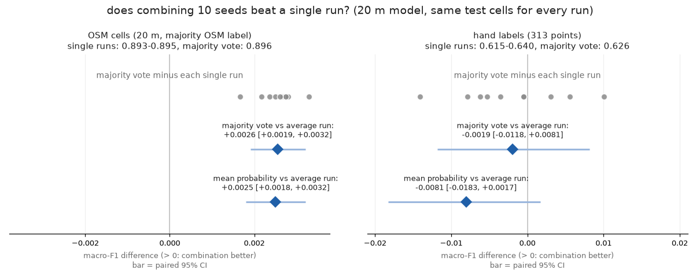

# Seed sensitivity of the 20 m land-use map

**Question:** if the 20 m model is retrained with a different random seed, how many pixels change
class, and is a map that combines several seeds better than a single run?

## Summary

- **Pixels do flip, but only at the edges between classes.**
  - Across HMDA, **10% of cells change class in at least one of 10 runs**. Any one run differs from
    the 10-run majority on **2.4%** of cells.
  - In dense urban areas it is 16–31% and 4–8%.
  - Most flips are **residential ↔ non-residential** in the city and **forest ↔ open** outside it.
- **Totals barely move.** A class's share of HMDA varies by < 0.25 points between runs, and of a
  4 × 4 km area by about ±1 point (at most ±2).
- **Combining seeds helps a little.** On 191k OSM-labelled test cells, a 10-seed majority vote is
  +0.003 macro-F1 better than a single run (section 4). The 313-point hand-label test is too small to detect
  a gain this small.
- **Recommendation:** one run with a fixed seed is enough for analysis and zone totals. For the
  published map, average the probabilities of **5 seeds**: that gets most of the gain and cuts
  flipping by about 60%.
- **Full HMDA map done** with 5 seeds: 19.1 M cells in 32 min (section 3).

## Set-up

- **Model:** the 20 m LightGBM from `../res100` (181 features, 400 trees).
- **What the seed changes:**
  - which training cells are drawn (≤ 100 per class per 4 km tile, the res100 cap; the main pipeline
    uses 200 pixels at 10 m and draws them once, with a fixed seed). Each run has 191,273 cells;
  - LightGBM's internal row and column sampling.
- **Runs:** seeds 1–10. Each predicts seven 4 × 4 km areas, the hand-labelled test points, and a 1%
  random sample of HMDA (191k cells).
- **Combining runs:**
  - **majority vote** (ties go to the higher mean probability);
  - **vote share** per class (8 of 10 runs non-residential → 80% non-residential);
  - **mean probability** per class.

## 1. How many pixels flip?

| area | cells that change in ≥ 1 of 10 runs | one run vs the majority: cells that differ | winning class has ≤ 7 of 10 votes |
|---|---|---|---|
| Old City (Charminar) — dense housing, bazaars | 16.2% | 4.0% | 7.2% |
| Secunderabad — mixed | 23.4% | 5.6% | 9.7% |
| HITEC City — IT offices, high-rise housing | 29.1% | 7.1% | 12.7% |
| Financial District — IT campuses, construction | 31.1% | 7.8% | 14.1% |
| Lingampally — suburban housing | 26.4% | 6.5% | 11.6% |
| Jeedimetla — industrial | 17.4% | 4.3% | 7.7% |
| Shamshabad — peri-urban fringe | 21.9% | 5.6% | 10.3% |
| **HMDA (1% sample)** | **9.8%** | **2.4%** | **4.2%** |

**Which classes the flipping cells switch between** (% of flipping cells):

| area | residential ↔ non-res. | non-res. ↔ open | forest ↔ open | non-res. ↔ forest |
|---|---|---|---|---|
| Old City | 83% | 9% | 3% | – |
| Secunderabad | 86% | 6% | 1% | 6% |
| HITEC City | 75% | 15% | 4% | 4% |
| Financial District | 36% | 39% | 11% | 12% |
| Lingampally | 65% | 11% | – | 9% |
| Jeedimetla | 56% | 7% | 18% | 16% |
| Shamshabad | 34% | 20% | 26% | – |
| HMDA (1% sample) | 23% | 20% | 38% | – |

- **Water** almost never flips: 85–99% of water cells are unanimous.
- **Non-residential** flips most: only 51–86% unanimous.
- **Open land inside the city** (small vacant plots) is also unstable, at 53–55% unanimous.

**More seeds, less flipping.** The table shows the share of cells that differ from the 10-run
majority, averaged over 30 random choices of seeds:

| | 1 seed | 3 seeds | 5 seeds |
|---|---|---|---|
| HMDA (sample) | 2.4% | 1.4% | 1.0% |
| Old City | 4.0% | 2.3% | 1.6% |
| HITEC City | 7.1% | 4.2% | 2.9% |
| Financial District | 7.9% | 4.7% | 3.2% |

## 2. Maps: all 10 runs and the majority vote

Each figure shows:
- the 10 runs;
- the **majority vote**;
- the **agreement** (dark = runs disagree);
- the share of runs voting non-residential.

At this scale the runs look nearly identical. The flips are scattered along class edges; whole
blocks never change.

### Old City (Charminar)

### Secunderabad

### HITEC City

### Financial District

### Lingampally

### Jeedimetla (industrial)

### Shamshabad (fringe)

## 3. Full HMDA map (5 seeds)

Every 20 m cell inside HMDA was predicted: 19,123,434 cells covering 7,649 km². The models were seeds
1–5, and the final class is the one with the highest mean probability.

| map | residential | non-residential | water | forest | open |
|---|---|---|---|---|---|
| 5 single runs, km² (min–max) | 803–810 | 624–635 | 223–226 | 1060–1071 | 4919–4932 |
| **final map, km²** | **807** | **622** | **225** | **1064** | **4931** |
| final map, % | 10.6 | 8.1 | 2.9 | 13.9 | 64.5 |

- **92.6%** of cells get the same class from all 5 runs, and **7.4%** flip in at least one.
- A single run differs from the final map on **2.3%** of cells.
- Prediction took **32 min** for all 5 seeds (~6.5 min per seed), using the cached features and the
  trained models. Ten seeds would take about 65 min.

## 4. Does combining seeds improve accuracy?

Two test sets:

**Hand labels.** 313 points labelled by hand (confidence ≤ 2).
- Each point is one 10 m pixel. It is scored against the 20 m cell that contains it; each 20 m cell is
  exactly 2 × 2 pixels.
- The test is small: only 39 points are non-residential.

**OSM labels.** These come from OpenStreetMap, the same source the model is trained on.
- **The final models can't be tested on them.** Their training cells come from all over HMDA, so
  any OSM-labelled spot is either training data or right next to it.
- **So the test models never see the area they are tested on:**
  - HMDA was cut into 74 squares of 12 × 12 km, grouped into 5 folds.
  - For each fold, a model was trained on the other 4 folds and predicted the test cells in this one.
  - This was repeated for every fold and every seed: 50 models.
  - **No test cell, and nothing within its 12 km square, was in that model's training data.**
- **Test cells:** 191,273 cells of 20 m, drawn at random (up to 100 per class per 4 km tile, fixed
  seed). OSM labels are a 10 m map, so a 20 m cell holds 4 label pixels. A cell is used if at least
  2 of its 4 pixels are labelled, and its label is the class with the most pixels. The model's
  prediction for the cell is compared with that label, so both sides describe the same 20 × 20 m.
- **Every seed is tested on exactly the same cells.** Differences between single runs and the
  combination are therefore paired, with no extra sampling noise.
- **OSM scores flatter the model.** OSM maps clear-cut areas well, so OSM scores (~0.90) run well
  above the hand-label score (~0.63). Here they serve only to compare single runs with combinations.

| test | single runs (10 seeds) | majority vote | gain over the average run [95% CI] |
|---|---|---|---|
| OSM labels (191k cells) | 0.8931–0.8948 | **0.8964** | **+0.0026 [+0.0019, +0.0032]** |
| hand labels (313) | 0.615–0.640 | 0.626 | −0.002 [−0.012, +0.008] |

Scores are macro-F1. Each interval comes from a paired bootstrap over 12 km squares (OSM) or strata
(hand labels).

- **On OSM labels, the majority vote beats every single run, including the best one.** The gain is
  mostly in non-residential (F1 0.711 → 0.717). Averaging probabilities scores the same as voting.
- **On hand labels, there is no detectable difference.** That test can't resolve gains below about
  0.02, so this is not evidence against the OSM result.
- **How many seeds:** 3 seeds give about two-thirds of the gain and 5 about 85%. Macro-F1 is 0.8939
  for 1 seed, 0.8955 for 3, 0.8960 for 5 and 0.8964 for 10.
- **The seed is not what limits accuracy.** The gain (~0.003) is tiny next to the model's real error;
  non-residential F1 is about 0.43 on the hand labels.

## 5. Recommendation

| use | runs | why |
|---|---|---|
| analysis, zone totals | **1 run, fixed seed** | seed noise is ~1 point per 16 km² zone and < 0.25 points HMDA-wide, much less than the model's own error |
| published or year-to-year maps | **5 seeds, mean probability** | flipping drops ~60%; accuracy rises slightly; vote share gives a per-pixel uncertainty layer; ~32 min for HMDA |

Going beyond 5 seeds adds little.
