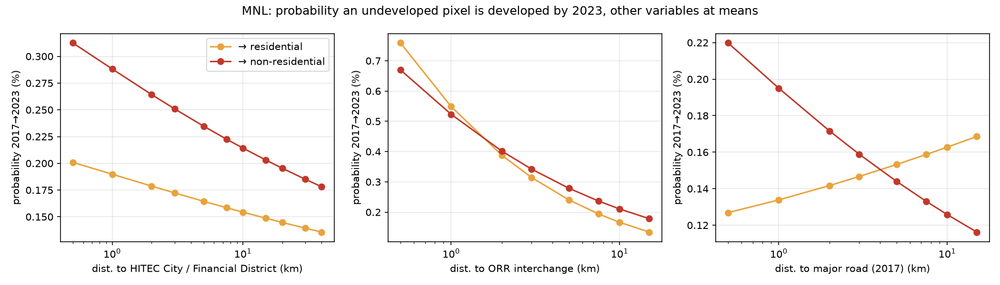
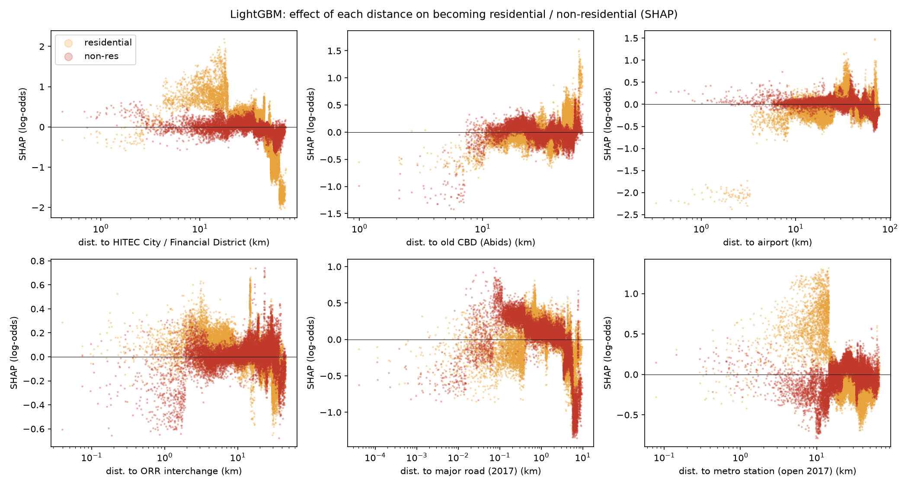

# Land-use transition models, HMDA 2017 → 2023

*Auto-generated by `scripts/lu/22_choice_models.py`.*

- Sample: 333,600 random 10 m pixels; **299,453 undeveloped in 2017** are modelled.
- Outcome among them: stays undeveloped 99.3%, becomes residential 0.37%, becomes non-residential 0.33%.
- Development is read from Open Buildings 2.5D building cover; the function of new development comes from the 53-feature physical model (2023).
- Distances enter as standardised ln(km + 0.1): a negative coefficient means **closer → more likely**.
- Standard errors are clustered by 4 km tile.

## A. Binary logit: developed by 2023

McFadden pseudo-R² 0.172. Spatial-block CV AUC: logit **0.858**, LightGBM **0.885**.

|                                          |   coef |    se |     p |   odds_ratio | sig   |
|:-----------------------------------------|-------:|------:|------:|-------------:|:------|
| const                                    | -5.675 | 0.069 | 0     |        0.003 | ***   |
| dist. to HITEC City / Financial District | -0.053 | 0.055 | 0.33  |        0.948 |       |
| dist. to old CBD (Abids)                 | -0.175 | 0.111 | 0.114 |        0.839 |       |
| dist. to airport                         |  0.032 | 0.073 | 0.657 |        1.033 |       |
| dist. to ORR interchange                 | -0.377 | 0.053 | 0     |        0.686 | ***   |
| dist. to major road (2017)               | -0.057 | 0.048 | 0.231 |        0.945 |       |
| dist. to metro station (open 2017)       | -0.196 | 0.078 | 0.012 |        0.822 | *     |
| building cover within 610 m (2017)       |  0.134 | 0.033 | 0     |        1.144 | ***   |
| building cover within 150 m (2017)       |  0.145 | 0.017 | 0     |        1.156 | ***   |
| NDVI within 150 m (2017)                 | -0.572 | 0.047 | 0     |        0.565 | ***   |
| night lights within 610 m (2017)         | -0.05  | 0.045 | 0.262 |        0.951 |       |
| start class = forest/trees               | -0.247 | 0.126 | 0.05  |        0.781 |       |

## B. Multinomial logit: none / residential / non-residential

McFadden pseudo-R² 0.160; standard errors cluster(tile).

|                                          |   residential vs none |   non-residential vs none | residential vs none sig   | non-residential vs none sig   |
|:-----------------------------------------|----------------------:|--------------------------:|:--------------------------|:------------------------------|
| const                                    |                -6.474 |                    -6.312 | ***                       | ***                           |
| dist. to HITEC City / Financial District |                -0.048 |                    -0.069 |                           |                               |
| dist. to old CBD (Abids)                 |                -0.395 |                     0.077 | **                        |                               |
| dist. to airport                         |                 0.158 |                    -0.087 |                           |                               |
| dist. to ORR interchange                 |                -0.439 |                    -0.336 | ***                       | ***                           |
| dist. to major road (2017)               |                 0.086 |                    -0.194 |                           | ***                           |
| dist. to metro station (open 2017)       |                -0.26  |                    -0.136 | **                        |                               |
| building cover within 610 m (2017)       |                 0.174 |                     0.091 | ***                       | *                             |
| building cover within 150 m (2017)       |                 0.143 |                     0.148 | ***                       | ***                           |
| NDVI within 150 m (2017)                 |                -0.571 |                    -0.563 | ***                       | ***                           |
| night lights within 610 m (2017)         |                -0.161 |                     0.054 | *                         |                               |
| start class = forest/trees               |                -0.696 |                     0.054 | **                        |                               |

## C. LightGBM + SHAP (non-linear distance decay)

Mean |SHAP| per class:

|                   |   none |   residential |   non_res |
|:------------------|-------:|--------------:|----------:|
| viirs_61_2017     |  0.454 |         0.399 |     0.28  |
| ndvi_15_2017      |  0.46  |         0.324 |     0.24  |
| d_major_road_2017 |  0.21  |         0.194 |     0.214 |
| d_employment      |  0.189 |         0.466 |     0.105 |
| d_metro_2017      |  0.128 |         0.203 |     0.102 |
| d_airport_rgia    |  0.141 |         0.153 |     0.092 |
| d_cbd_abids       |  0.148 |         0.17  |     0.089 |
| cov_61_2017       |  0.241 |         0.269 |     0.087 |
| d_orr_access      |  0.198 |         0.108 |     0.073 |
| cov_15_2017       |  0.201 |         0.265 |     0.029 |
| forest_2017       |  0.016 |         0.032 |     0.022 |

## D. Context classification: separate MNLs by context

**By density**: coefficients for *non-residential vs none*.

|                                          | medium (n=99,817, nonres=142)   | high (n=99,818, nonres=762)   |
|:-----------------------------------------|:--------------------------------|:------------------------------|
| const                                    | -6.638***                       | -5.695***                     |
| dist. to HITEC City / Financial District | 0.054                           | -0.06                         |
| dist. to old CBD (Abids)                 | 0.549                           | 0.066                         |
| dist. to airport                         | -0.065                          | -0.088                        |
| dist. to ORR interchange                 | -0.318*                         | -0.275***                     |
| dist. to major road (2017)               | -0.131                          | -0.092                        |
| dist. to metro station (open 2017)       | -0.481                          | -0.095                        |
| building cover within 150 m (2017)       | 0.573                           | 0.152***                      |
| NDVI within 150 m (2017)                 | -0.608***                       | -0.552***                     |
| night lights within 610 m (2017)         | 0.58**                          | 0.076**                       |
| start class = forest/trees               | 0.111                           | 0.42*                         |

**By ring**: coefficients for *non-residential vs none*.

|                                          | core <10 km (n=3,245, nonres=52)   | middle 10-25 km (n=48,244, nonres=494)   | periphery >25 km (n=247,964, nonres=439)   |
|:-----------------------------------------|:-----------------------------------|:-----------------------------------------|:-------------------------------------------|
| const                                    | -3.496                             | -5.626***                                | -6.635***                                  |
| dist. to HITEC City / Financial District | 0.513                              | -0.017                                   | -0.336*                                    |
| dist. to old CBD (Abids)                 | 0.354                              | -0.154                                   | -0.082                                     |
| dist. to airport                         | -0.389                             | 0.036                                    | 0.265                                      |
| dist. to ORR interchange                 | -0.744                             | -0.202**                                 | -0.259                                     |
| dist. to major road (2017)               | 0.048                              | -0.073                                   | -0.223***                                  |
| dist. to metro station (open 2017)       | -0.197                             | 0.01                                     | 0.431                                      |
| building cover within 150 m (2017)       | 0.069                              | 0.149***                                 | 0.247***                                   |
| NDVI within 150 m (2017)                 | -0.467***                          | -0.421***                                | -0.734***                                  |
| night lights within 610 m (2017)         | -0.007                             | 0.15***                                  | 0.594***                                   |
| start class = forest/trees               | -0.204                             | -0.242                                   | 0.233                                      |

## E. Robustness (binary logit distance coefficients)

|                                          |   main |   developed = cover >=10% |   developed = cover >=30% |   start = SIS-DP 2016-19 open/forest |   2023 roads (endogenous) |   metro open by 2020 |
|:-----------------------------------------|-------:|--------------------------:|--------------------------:|-------------------------------------:|--------------------------:|---------------------:|
| dist. to HITEC City / Financial District | -0.053 |                    -0.074 |                    -0.065 |                               -0.082 |                    -0.054 |               -0.11  |
| dist. to old CBD (Abids)                 | -0.175 |                    -0.167 |                    -0.133 |                               -0.143 |                    -0.17  |               -0.342 |
| dist. to airport                         |  0.032 |                     0.035 |                     0.007 |                                0.04  |                     0.029 |                0.119 |
| dist. to ORR interchange                 | -0.377 |                    -0.319 |                    -0.397 |                               -0.332 |                    -0.368 |               -0.37  |
| dist. to major road (2017)               | -0.057 |                    -0.084 |                    -0.046 |                               -0.225 |                    -0.096 |               -0.064 |
| dist. to metro station (open 2017)       | -0.196 |                    -0.177 |                    -0.218 |                               -0.225 |                    -0.195 |                0.01  |

