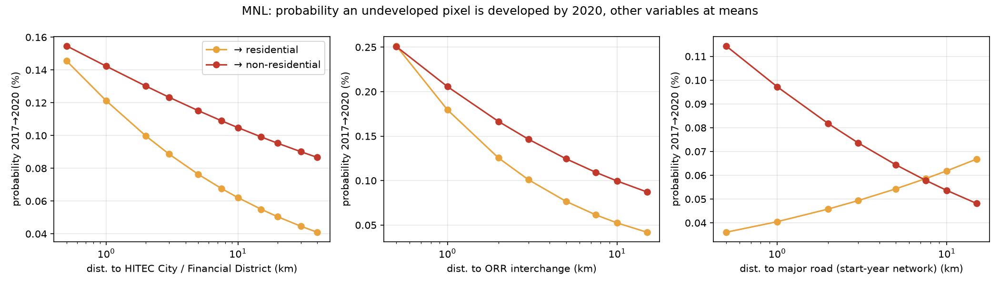
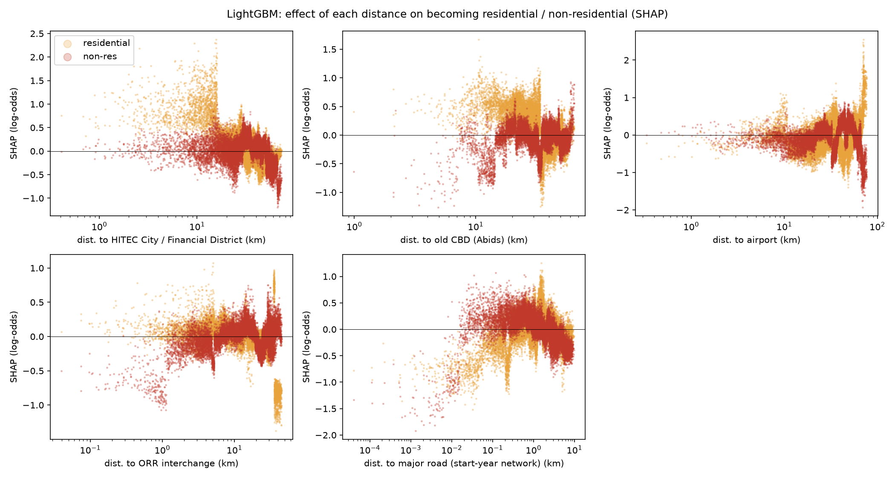

# Land-use transition models, HMDA 2017 → 2020

*Auto-generated by `scripts/lu/22_choice_models.py`.*

- Sample: 333,600 random 10 m pixels; **299,453 undeveloped in 2017** are modelled.
- Outcome among them: stays undeveloped 99.7%, becomes residential 0.16%, becomes non-residential 0.17%.
- Development is read from Open Buildings 2.5D building cover; the function of new development comes from the 53-feature physical model applied to 2020 inputs.
- Distances enter as standardised ln(km + 0.1): a negative coefficient means **closer → more likely**.
- Standard errors are clustered by 4 km tile.

## A. Binary logit: developed by 2020

McFadden pseudo-R² 0.186. Spatial-block CV AUC: logit **0.876**, LightGBM **0.906**.

|                                          |   coef |    se |     p |   odds_ratio | sig   |
|:-----------------------------------------|-------:|------:|------:|-------------:|:------|
| const                                    | -6.546 | 0.082 | 0     |        0.001 | ***   |
| dist. to HITEC City / Financial District | -0.111 | 0.053 | 0.036 |        0.895 | *     |
| dist. to old CBD (Abids)                 | -0.289 | 0.098 | 0.003 |        0.749 | **    |
| dist. to airport                         |  0.074 | 0.076 | 0.33  |        1.076 |       |
| dist. to ORR interchange                 | -0.338 | 0.057 | 0     |        0.713 | ***   |
| dist. to major road (start-year network) | -0.06  | 0.05  | 0.232 |        0.942 |       |
| building cover within 610 m (start)      |  0.117 | 0.04  | 0.004 |        1.124 | **    |
| building cover within 150 m (start)      |  0.167 | 0.023 | 0     |        1.182 | ***   |
| NDVI within 150 m (start)                | -0.739 | 0.059 | 0     |        0.478 | ***   |
| night lights within 610 m (start)        | -0.027 | 0.044 | 0.538 |        0.973 |       |
| start class = forest/trees               | -0.303 | 0.197 | 0.125 |        0.739 |       |

## B. Multinomial logit: none / residential / non-residential

McFadden pseudo-R² 0.177; standard errors cluster(tile).

|                                          |   residential vs none |   non-residential vs none | residential vs none sig   | non-residential vs none sig   |
|:-----------------------------------------|----------------------:|--------------------------:|:--------------------------|:------------------------------|
| const                                    |                -7.603 |                    -7.005 | ***                       | ***                           |
| dist. to HITEC City / Financial District |                -0.155 |                    -0.071 | *                         |                               |
| dist. to old CBD (Abids)                 |                -0.526 |                    -0.075 | ***                       |                               |
| dist. to airport                         |                 0.156 |                     0.001 |                           |                               |
| dist. to ORR interchange                 |                -0.451 |                    -0.266 | ***                       | ***                           |
| dist. to major road (start-year network) |                 0.188 |                    -0.263 | *                         | ***                           |
| building cover within 610 m (start)      |                 0.231 |                    -0.011 | ***                       |                               |
| building cover within 150 m (start)      |                 0.147 |                     0.193 | ***                       | ***                           |
| NDVI within 150 m (start)                |                -0.856 |                    -0.622 | ***                       | ***                           |
| night lights within 610 m (start)        |                -0.179 |                     0.112 | **                        | **                            |
| start class = forest/trees               |                -0.917 |                    -0.133 | *                         |                               |

## C. LightGBM + SHAP (non-linear distance decay)

Mean |SHAP| per class:

|                 |   none |   residential |   non_res |
|:----------------|-------:|--------------:|----------:|
| cov_61_t0       |  0.238 |         0.401 |     0.451 |
| ndvi_15_t0      |  0.456 |         0.23  |     0.305 |
| viirs_61_t0     |  0.364 |         0.596 |     0.276 |
| d_airport_rgia  |  0.258 |         0.302 |     0.26  |
| d_employment    |  0.218 |         0.258 |     0.2   |
| d_major_road_t0 |  0.371 |         0.219 |     0.196 |
| d_cbd_abids     |  0.193 |         0.232 |     0.133 |
| d_orr_access    |  0.201 |         0.124 |     0.133 |
| cov_15_t0       |  0.241 |         0.19  |     0.084 |
| forest_t0       |  0.118 |         0.002 |     0.01  |

## D. Context classification: separate MNLs by context

**By density**: coefficients for *non-residential vs none*.

|                                          | high (n=99,818, nonres=415)   |
|:-----------------------------------------|:------------------------------|
| const                                    | -6.279***                     |
| dist. to HITEC City / Financial District | -0.066                        |
| dist. to old CBD (Abids)                 | 0.003                         |
| dist. to airport                         | 0.003                         |
| dist. to ORR interchange                 | -0.203**                      |
| dist. to major road (start-year network) | -0.108*                       |
| building cover within 150 m (start)      | 0.151***                      |
| NDVI within 150 m (start)                | -0.605***                     |
| night lights within 610 m (start)        | 0.108***                      |
| start class = forest/trees               | 0.312                         |

**By ring**: coefficients for *non-residential vs none*.

|                                          | core <10 km (n=3,245, nonres=33)   | middle 10-25 km (n=48,244, nonres=254)   | periphery >25 km (n=247,964, nonres=221)   |
|:-----------------------------------------|:-----------------------------------|:-----------------------------------------|:-------------------------------------------|
| const                                    | -4.049***                          | -6.458***                                | -7.458***                                  |
| dist. to HITEC City / Financial District | 0.535                              | 0.0                                      | -0.268                                     |
| dist. to old CBD (Abids)                 | 0.204                              | -0.237                                   | 0.36                                       |
| dist. to airport                         | -0.085                             | 0.05                                     | 0.272                                      |
| dist. to ORR interchange                 | -0.72                              | -0.149                                   | -0.194                                     |
| dist. to major road (start-year network) | -0.274                             | -0.145                                   | -0.259***                                  |
| building cover within 150 m (start)      | 0.068                              | 0.115***                                 | 0.307***                                   |
| NDVI within 150 m (start)                | -0.494**                           | -0.479***                                | -0.8***                                    |
| night lights within 610 m (start)        | 0.036                              | 0.172***                                 | 0.371**                                    |
| start class = forest/trees               | -8.939***                          | -0.199                                   | -0.295                                     |

## E. Robustness (binary logit distance coefficients)

|                                          |    main |   developed = cover >=10% |   developed = cover >=30% |   start = SIS-DP 2016-19 open/forest |   end-year roads (endogenous) |   + metro (open at start) |   + metro (open by 2020) |
|:-----------------------------------------|--------:|--------------------------:|--------------------------:|-------------------------------------:|------------------------------:|--------------------------:|-------------------------:|
| dist. to HITEC City / Financial District |  -0.111 |                    -0.117 |                    -0.109 |                               -0.133 |                        -0.11  |                    -0.065 |                   -0.123 |
| dist. to old CBD (Abids)                 |  -0.289 |                    -0.274 |                    -0.219 |                               -0.314 |                        -0.285 |                    -0.172 |                   -0.317 |
| dist. to airport                         |   0.074 |                     0.126 |                     0.061 |                                0.126 |                         0.073 |                     0.011 |                    0.084 |
| dist. to ORR interchange                 |  -0.338 |                    -0.311 |                    -0.357 |                               -0.308 |                        -0.331 |                    -0.346 |                   -0.336 |
| dist. to major road (start-year network) |  -0.06  |                    -0.073 |                    -0.105 |                               -0.271 |                        -0.092 |                    -0.052 |                   -0.061 |
| dist. to metro station (open at start)   | nan     |                   nan     |                   nan     |                              nan     |                       nan     |                    -0.158 |                  nan     |
| dist. to metro station (open 2020)       | nan     |                   nan     |                   nan     |                              nan     |                       nan     |                   nan     |                    0.035 |

