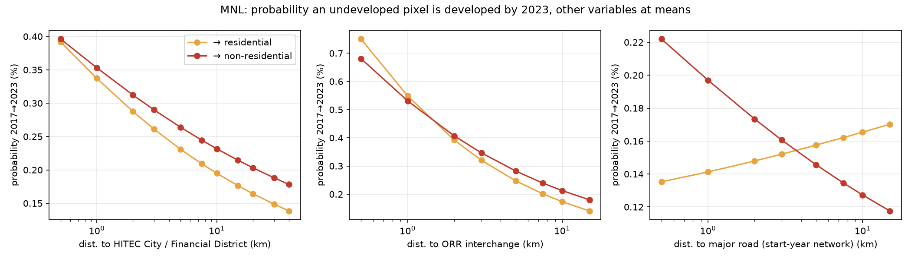
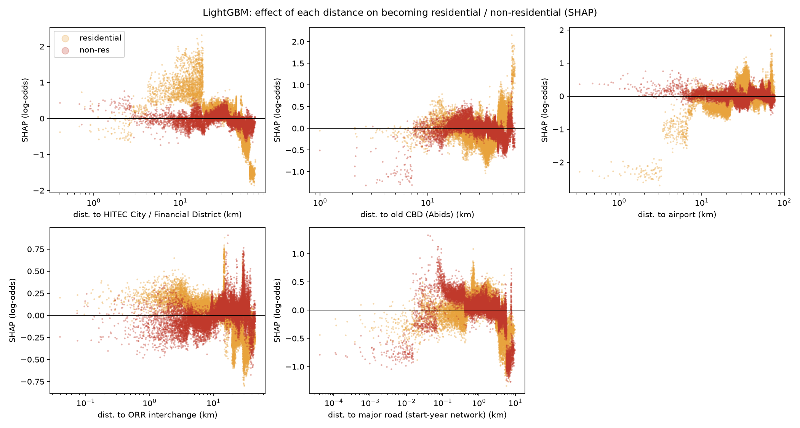

# Land-use transition models, HMDA 2017 → 2023

*Auto-generated by `scripts/lu/22_choice_models.py`.*

- Sample: 333,600 random 10 m pixels; **299,453 undeveloped in 2017** are modelled.
- Outcome among them: stays undeveloped 99.3%, becomes residential 0.37%, becomes non-residential 0.33%.
- Development is read from Open Buildings 2.5D building cover; the function of new development comes from the 53-feature physical model applied to 2023 inputs.
- Distances enter as standardised ln(km + 0.1): a negative coefficient means **closer → more likely**.
- Standard errors are clustered by 4 km tile.

## A. Binary logit: developed by 2023

McFadden pseudo-R² 0.170. Spatial-block CV AUC: logit **0.859**, LightGBM **0.888**.

|                                          |   coef |    se |     p |   odds_ratio | sig   |
|:-----------------------------------------|-------:|------:|------:|-------------:|:------|
| const                                    | -5.655 | 0.07  | 0     |        0.003 | ***   |
| dist. to HITEC City / Financial District | -0.107 | 0.055 | 0.053 |        0.899 |       |
| dist. to old CBD (Abids)                 | -0.334 | 0.1   | 0.001 |        0.716 | ***   |
| dist. to airport                         |  0.116 | 0.072 | 0.106 |        1.123 |       |
| dist. to ORR interchange                 | -0.37  | 0.054 | 0     |        0.691 | ***   |
| dist. to major road (start-year network) | -0.064 | 0.047 | 0.171 |        0.938 |       |
| building cover within 610 m (start)      |  0.158 | 0.034 | 0     |        1.171 | ***   |
| building cover within 150 m (start)      |  0.144 | 0.017 | 0     |        1.155 | ***   |
| NDVI within 150 m (start)                | -0.578 | 0.048 | 0     |        0.561 | ***   |
| night lights within 610 m (start)        | -0.07  | 0.048 | 0.145 |        0.932 |       |
| start class = forest/trees               | -0.231 | 0.125 | 0.065 |        0.794 |       |

## B. Multinomial logit: none / residential / non-residential

McFadden pseudo-R² 0.158; standard errors cluster(tile).

|                                          |   residential vs none |   non-residential vs none | residential vs none sig   | non-residential vs none sig   |
|:-----------------------------------------|----------------------:|--------------------------:|:--------------------------|:------------------------------|
| const                                    |                -6.429 |                    -6.304 | ***                       | ***                           |
| dist. to HITEC City / Financial District |                -0.127 |                    -0.098 |                           | *                             |
| dist. to old CBD (Abids)                 |                -0.583 |                    -0.041 | ***                       |                               |
| dist. to airport                         |                 0.271 |                    -0.032 | **                        |                               |
| dist. to ORR interchange                 |                -0.424 |                    -0.337 | ***                       | ***                           |
| dist. to major road (start-year network) |                 0.07  |                    -0.193 |                           | ***                           |
| building cover within 610 m (start)      |                 0.206 |                     0.106 | ***                       | **                            |
| building cover within 150 m (start)      |                 0.143 |                     0.147 | ***                       | ***                           |
| NDVI within 150 m (start)                |                -0.58  |                    -0.567 | ***                       | ***                           |
| night lights within 610 m (start)        |                -0.183 |                     0.044 | **                        |                               |
| start class = forest/trees               |                -0.676 |                     0.068 | **                        |                               |

## C. LightGBM + SHAP (non-linear distance decay)

Mean |SHAP| per class:

|                 |   none |   residential |   non_res |
|:----------------|-------:|--------------:|----------:|
| ndvi_15_t0      |  0.5   |         0.321 |     0.236 |
| viirs_61_t0     |  0.41  |         0.521 |     0.219 |
| d_major_road_t0 |  0.208 |         0.229 |     0.172 |
| d_cbd_abids     |  0.167 |         0.256 |     0.126 |
| d_employment    |  0.228 |         0.364 |     0.12  |
| cov_61_t0       |  0.227 |         0.227 |     0.105 |
| d_orr_access    |  0.168 |         0.167 |     0.097 |
| d_airport_rgia  |  0.173 |         0.202 |     0.09  |
| cov_15_t0       |  0.186 |         0.276 |     0.036 |
| forest_t0       |  0.015 |         0.02  |     0.009 |

## D. Context classification: separate MNLs by context

**By density**: coefficients for *non-residential vs none*.

|                                          | medium (n=99,817, nonres=142)   | high (n=99,818, nonres=762)   |
|:-----------------------------------------|:--------------------------------|:------------------------------|
| const                                    | -6.642***                       | -5.686***                     |
| dist. to HITEC City / Financial District | -0.011                          | -0.08                         |
| dist. to old CBD (Abids)                 | 0.077                           | -0.022                        |
| dist. to airport                         | 0.129                           | -0.046                        |
| dist. to ORR interchange                 | -0.333*                         | -0.27***                      |
| dist. to major road (start-year network) | -0.121                          | -0.094                        |
| building cover within 150 m (start)      | 0.523                           | 0.154***                      |
| NDVI within 150 m (start)                | -0.61***                        | -0.555***                     |
| night lights within 610 m (start)        | 0.659***                        | 0.074*                        |
| start class = forest/trees               | 0.075                           | 0.424*                        |

**By ring**: coefficients for *non-residential vs none*.

|                                          | core <10 km (n=3,245, nonres=52)   | middle 10-25 km (n=48,244, nonres=494)   | periphery >25 km (n=247,964, nonres=439)   |
|:-----------------------------------------|:-----------------------------------|:-----------------------------------------|:-------------------------------------------|
| const                                    | -2.228                             | -5.641***                                | -6.636***                                  |
| dist. to HITEC City / Financial District | 0.437                              | -0.017                                   | -0.242                                     |
| dist. to old CBD (Abids)                 | 0.37                               | -0.152                                   | 0.319                                      |
| dist. to airport                         | -0.049                             | 0.031                                    | 0.085                                      |
| dist. to ORR interchange                 | -0.464                             | -0.204**                                 | -0.222                                     |
| dist. to major road (start-year network) | -0.004                             | -0.073                                   | -0.231***                                  |
| building cover within 150 m (start)      | 0.065                              | 0.149***                                 | 0.25***                                    |
| NDVI within 150 m (start)                | -0.483***                          | -0.42***                                 | -0.741***                                  |
| night lights within 610 m (start)        | -0.021                             | 0.149***                                 | 0.565***                                   |
| start class = forest/trees               | -0.242                             | -0.248                                   | 0.175                                      |

## E. Robustness (binary logit distance coefficients)

|                                          |    main |   developed = cover >=10% |   developed = cover >=30% |   start = SIS-DP 2016-19 open/forest |   end-year roads (endogenous) |   + metro (open at start) |   + metro (open by 2020) |
|:-----------------------------------------|--------:|--------------------------:|--------------------------:|-------------------------------------:|------------------------------:|--------------------------:|-------------------------:|
| dist. to HITEC City / Financial District |  -0.107 |                    -0.119 |                    -0.125 |                               -0.133 |                        -0.107 |                    -0.053 |                   -0.11  |
| dist. to old CBD (Abids)                 |  -0.334 |                    -0.318 |                    -0.303 |                               -0.349 |                        -0.327 |                    -0.175 |                   -0.342 |
| dist. to airport                         |   0.116 |                     0.112 |                     0.098 |                                0.151 |                         0.112 |                     0.032 |                    0.119 |
| dist. to ORR interchange                 |  -0.37  |                    -0.316 |                    -0.388 |                               -0.334 |                        -0.362 |                    -0.377 |                   -0.37  |
| dist. to major road (start-year network) |  -0.064 |                    -0.088 |                    -0.055 |                               -0.227 |                        -0.103 |                    -0.057 |                   -0.064 |
| dist. to metro station (open at start)   | nan     |                   nan     |                   nan     |                              nan     |                       nan     |                    -0.196 |                  nan     |
| dist. to metro station (open 2020)       | nan     |                   nan     |                   nan     |                              nan     |                       nan     |                   nan     |                    0.01  |

