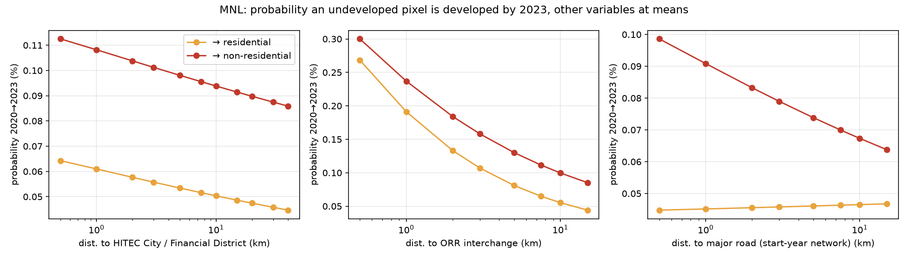
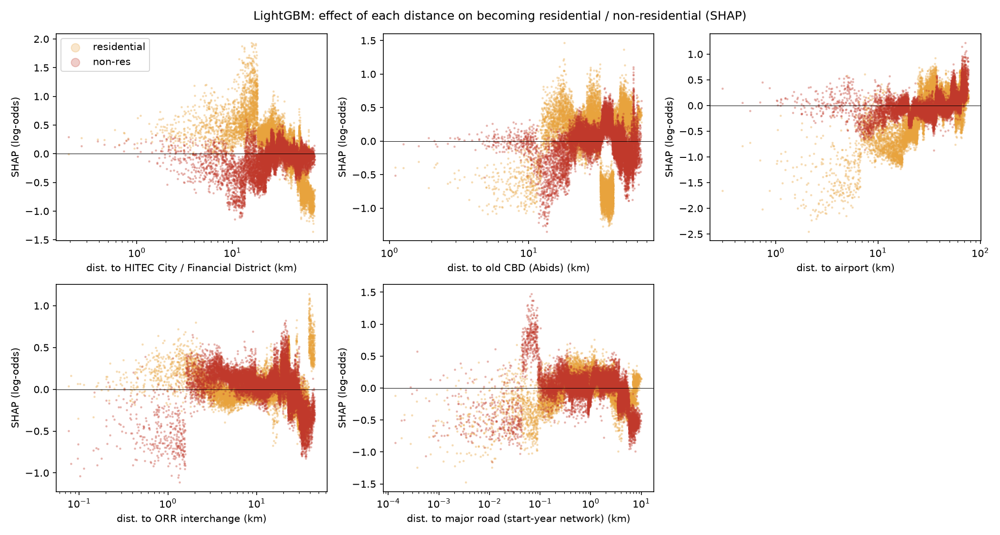

# Land-use transition models, HMDA 2020 → 2023

*Auto-generated by `scripts/lu/22_choice_models.py`.*

- Sample: 333,600 random 10 m pixels; **298,341 undeveloped in 2020** are modelled.
- Outcome among them: stays undeveloped 99.7%, becomes residential 0.15%, becomes non-residential 0.17%.
- Development is read from Open Buildings 2.5D building cover; the function of new development comes from the 53-feature physical model applied to 2023 inputs.
- Distances enter as standardised ln(km + 0.1): a negative coefficient means **closer → more likely**.
- Standard errors are clustered by 4 km tile.

## A. Binary logit: developed by 2023

McFadden pseudo-R² 0.180. Spatial-block CV AUC: logit **0.877**, LightGBM **0.894**.

|                                          |   coef |    se |     p |   odds_ratio | sig   |
|:-----------------------------------------|-------:|------:|------:|-------------:|:------|
| const                                    | -6.605 | 0.075 | 0     |        0.001 | ***   |
| dist. to HITEC City / Financial District | -0.027 | 0.058 | 0.639 |        0.973 |       |
| dist. to old CBD (Abids)                 | -0.235 | 0.084 | 0.005 |        0.791 | **    |
| dist. to airport                         |  0.054 | 0.068 | 0.425 |        1.056 |       |
| dist. to ORR interchange                 | -0.381 | 0.051 | 0     |        0.683 | ***   |
| dist. to major road (start-year network) | -0.064 | 0.054 | 0.241 |        0.938 |       |
| building cover within 610 m (start)      |  0.214 | 0.037 | 0     |        1.239 | ***   |
| building cover within 150 m (start)      |  0.102 | 0.021 | 0     |        1.108 | ***   |
| NDVI within 150 m (start)                | -0.85  | 0.052 | 0     |        0.427 | ***   |
| night lights within 610 m (start)        | -0.093 | 0.045 | 0.038 |        0.911 | *     |
| start class = forest/trees               | -0.12  | 0.279 | 0.667 |        0.887 |       |

## B. Multinomial logit: none / residential / non-residential

McFadden pseudo-R² 0.169; standard errors cluster(tile).

|                                          |   residential vs none |   non-residential vs none | residential vs none sig   | non-residential vs none sig   |
|:-----------------------------------------|----------------------:|--------------------------:|:--------------------------|:------------------------------|
| const                                    |                -7.622 |                    -7.068 | ***                       | ***                           |
| dist. to HITEC City / Financial District |                -0.044 |                    -0.033 |                           |                               |
| dist. to old CBD (Abids)                 |                -0.407 |                    -0.12  | ***                       |                               |
| dist. to airport                         |                 0.237 |                    -0.063 | *                         |                               |
| dist. to ORR interchange                 |                -0.453 |                    -0.316 | ***                       | ***                           |
| dist. to major road (start-year network) |                 0.013 |                    -0.133 |                           | *                             |
| building cover within 610 m (start)      |                 0.314 |                     0.123 | ***                       | *                             |
| building cover within 150 m (start)      |                 0.092 |                     0.112 | **                        | ***                           |
| NDVI within 150 m (start)                |                -0.945 |                    -0.774 | ***                       | ***                           |
| night lights within 610 m (start)        |                -0.23  |                    -0.007 | **                        |                               |
| start class = forest/trees               |                -0.896 |                     0.241 |                           |                               |

## C. LightGBM + SHAP (non-linear distance decay)

Mean |SHAP| per class:

|                 |   none |   residential |   non_res |
|:----------------|-------:|--------------:|----------:|
| viirs_61_t0     |  0.521 |         0.413 |     0.462 |
| ndvi_15_t0      |  0.559 |         0.334 |     0.344 |
| cov_61_t0       |  0.313 |         0.287 |     0.208 |
| d_cbd_abids     |  0.149 |         0.398 |     0.183 |
| d_major_road_t0 |  0.289 |         0.155 |     0.176 |
| d_orr_access    |  0.288 |         0.142 |     0.165 |
| d_airport_rgia  |  0.199 |         0.278 |     0.132 |
| d_employment    |  0.184 |         0.31  |     0.127 |
| cov_15_t0       |  0.24  |         0.252 |     0.046 |
| forest_t0       |  0.013 |         0.18  |     0.007 |

## D. Context classification: separate MNLs by context

**By density**: coefficients for *non-residential vs none*.

|                                          | high (n=99,447, nonres=405)   |
|:-----------------------------------------|:------------------------------|
| const                                    | -6.359***                     |
| dist. to HITEC City / Financial District | -0.035                        |
| dist. to old CBD (Abids)                 | -0.121                        |
| dist. to airport                         | -0.057                        |
| dist. to ORR interchange                 | -0.237***                     |
| dist. to major road (start-year network) | 0.018                         |
| building cover within 150 m (start)      | 0.127***                      |
| NDVI within 150 m (start)                | -0.733***                     |
| night lights within 610 m (start)        | 0.025                         |
| start class = forest/trees               | 0.498                         |

**By ring**: coefficients for *non-residential vs none*.

|                                          | middle 10-25 km (n=47,113, nonres=262)   | periphery >25 km (n=248,133, nonres=232)   |
|:-----------------------------------------|:-----------------------------------------|:-------------------------------------------|
| const                                    | -6.083***                                | -7.266***                                  |
| dist. to HITEC City / Financial District | 0.004                                    | 0.064                                      |
| dist. to old CBD (Abids)                 | -0.062                                   | -0.267                                     |
| dist. to airport                         | 0.033                                    | 0.005                                      |
| dist. to ORR interchange                 | -0.136                                   | -0.149                                     |
| dist. to major road (start-year network) | 0.004                                    | -0.207*                                    |
| building cover within 150 m (start)      | 0.159***                                 | 0.171***                                   |
| NDVI within 150 m (start)                | -0.66***                                 | -0.858***                                  |
| night lights within 610 m (start)        | 0.076                                    | 0.495***                                   |
| start class = forest/trees               | -0.351                                   | -0.004                                     |

## E. Robustness (binary logit distance coefficients)

|                                          |    main |   developed = cover >=10% |   developed = cover >=30% |   end-year roads (endogenous) |   + metro (open at start) |   + metro (open by 2020) |
|:-----------------------------------------|--------:|--------------------------:|--------------------------:|------------------------------:|--------------------------:|-------------------------:|
| dist. to HITEC City / Financial District |  -0.027 |                    -0.041 |                    -0.072 |                        -0.029 |                    -0.028 |                   -0.028 |
| dist. to old CBD (Abids)                 |  -0.235 |                    -0.208 |                    -0.188 |                        -0.232 |                    -0.237 |                   -0.237 |
| dist. to airport                         |   0.054 |                     0.049 |                     0.023 |                         0.051 |                     0.055 |                    0.055 |
| dist. to ORR interchange                 |  -0.381 |                    -0.297 |                    -0.405 |                        -0.378 |                    -0.381 |                   -0.381 |
| dist. to major road (start-year network) |  -0.064 |                    -0.123 |                    -0.042 |                        -0.078 |                    -0.064 |                   -0.064 |
| dist. to metro station (open at start)   | nan     |                   nan     |                   nan     |                       nan     |                     0.002 |                  nan     |
| dist. to metro station (open 2020)       | nan     |                   nan     |                   nan     |                       nan     |                   nan     |                    0.002 |

