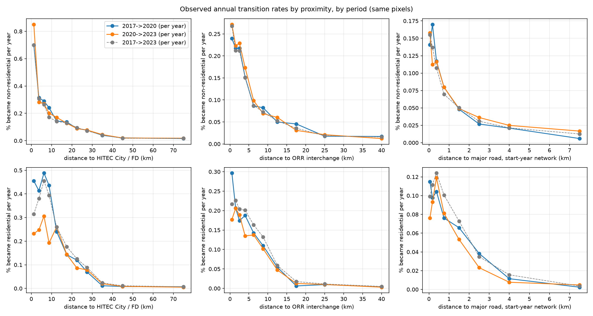

# Stability of proximity effects over time

*Auto-generated by `scripts/lu/24_period_compare.py`.*

Same pixels and code in every period. Each period uses the road network and metro stations as they were at its own start year. A negative distance coefficient means closer → more likely.

## Development rates

| period     |   n_undeveloped |   developed_% |   per_year_% |   residential_% |   non_res_% |   pseudoR2_binary |   pseudoR2_mnl |
|:-----------|----------------:|--------------:|-------------:|----------------:|------------:|------------------:|---------------:|
| 2017->2020 |          299453 |         0.332 |        0.111 |           0.163 |       0.17  |             0.186 |          0.177 |
| 2020->2023 |          298341 |         0.319 |        0.107 |           0.146 |       0.173 |             0.18  |          0.169 |
| 2017->2023 |          299453 |         0.699 |        0.117 |           0.37  |       0.329 |             0.17  |          0.158 |

## Binary logit (developed)

|                                          | 2017->2020   | 2020->2023   | 2017->2023   |
|:-----------------------------------------|:-------------|:-------------|:-------------|
| const                                    | -6.546***    | -6.605***    | -5.655***    |
| dist. to HITEC City / Financial District | -0.111*      | -0.027       | -0.107       |
| dist. to old CBD (Abids)                 | -0.289**     | -0.235**     | -0.334***    |
| dist. to airport                         | 0.074        | 0.054        | 0.116        |
| dist. to ORR interchange                 | -0.338***    | -0.381***    | -0.370***    |
| dist. to major road (start-year network) | -0.060       | -0.064       | -0.064       |
| building cover within 610 m (start)      | 0.117**      | 0.214***     | 0.158***     |
| building cover within 150 m (start)      | 0.167***     | 0.102***     | 0.144***     |
| NDVI within 150 m (start)                | -0.739***    | -0.850***    | -0.578***    |
| night lights within 610 m (start)        | -0.027       | -0.093*      | -0.070       |
| start class = forest/trees               | -0.303       | -0.120       | -0.231       |

## MNL: residential vs none

|                                          | 2017->2020   | 2020->2023   | 2017->2023   |
|:-----------------------------------------|:-------------|:-------------|:-------------|
| const                                    | -7.603***    | -7.622***    | -6.429***    |
| dist. to HITEC City / Financial District | -0.155*      | -0.044       | -0.127       |
| dist. to old CBD (Abids)                 | -0.526***    | -0.407***    | -0.583***    |
| dist. to airport                         | 0.156        | 0.237*       | 0.271**      |
| dist. to ORR interchange                 | -0.451***    | -0.453***    | -0.424***    |
| dist. to major road (start-year network) | 0.188*       | 0.013        | 0.070        |
| building cover within 610 m (start)      | 0.231***     | 0.314***     | 0.206***     |
| building cover within 150 m (start)      | 0.147***     | 0.092**      | 0.143***     |
| NDVI within 150 m (start)                | -0.856***    | -0.945***    | -0.580***    |
| night lights within 610 m (start)        | -0.179**     | -0.230**     | -0.183**     |
| start class = forest/trees               | -0.917*      | -0.896       | -0.676**     |

## MNL: non-residential vs none

|                                          | 2017->2020   | 2020->2023   | 2017->2023   |
|:-----------------------------------------|:-------------|:-------------|:-------------|
| const                                    | -7.005***    | -7.068***    | -6.304***    |
| dist. to HITEC City / Financial District | -0.071       | -0.033       | -0.098*      |
| dist. to old CBD (Abids)                 | -0.075       | -0.120       | -0.041       |
| dist. to airport                         | 0.001        | -0.063       | -0.032       |
| dist. to ORR interchange                 | -0.266***    | -0.316***    | -0.337***    |
| dist. to major road (start-year network) | -0.263***    | -0.133*      | -0.193***    |
| building cover within 610 m (start)      | -0.011       | 0.123*       | 0.106**      |
| building cover within 150 m (start)      | 0.193***     | 0.112***     | 0.147***     |
| NDVI within 150 m (start)                | -0.622***    | -0.774***    | -0.567***    |
| night lights within 610 m (start)        | 0.112**      | -0.007       | 0.044        |
| start class = forest/trees               | -0.133       | 0.241        | 0.068        |

